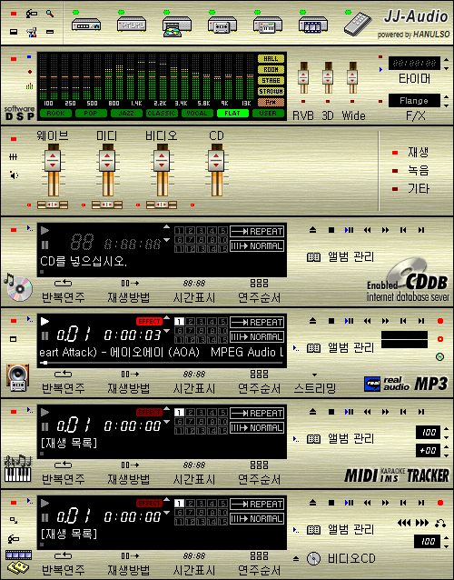
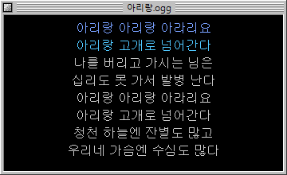
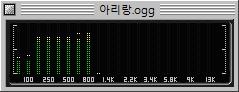
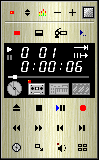
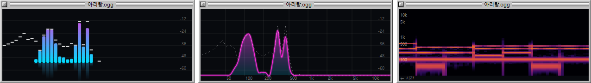
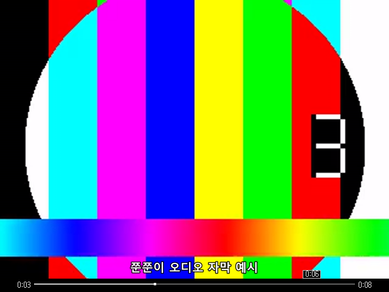
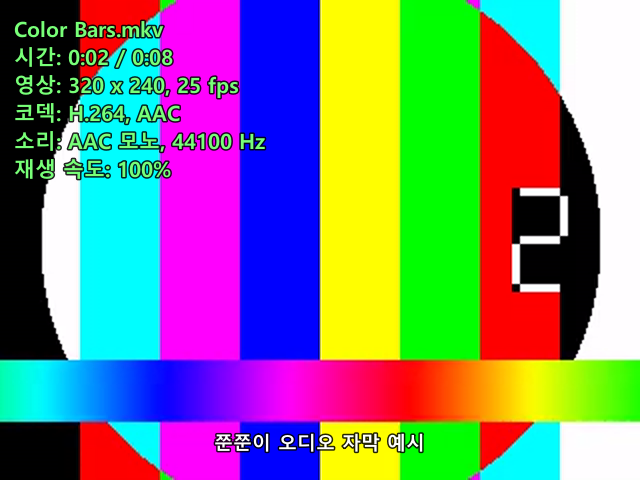
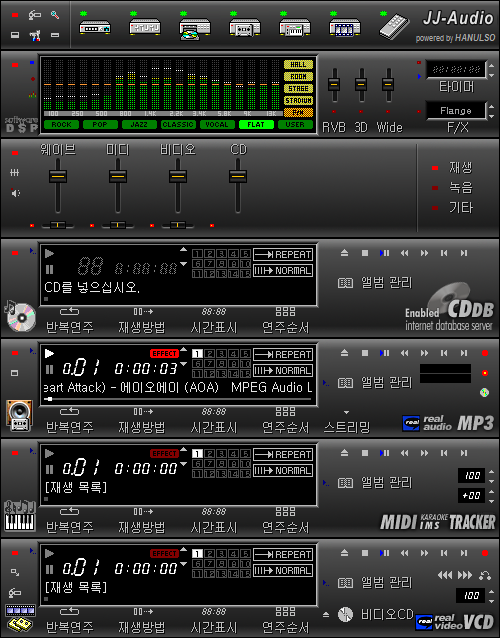
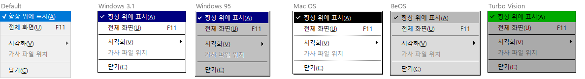

# JJ-Audio

A free music and video player for Windows that brings back the look and feel of the classic Jet-Audio 4.

## Download

1. Open the [latest release](https://github.com/hanulso78/jj-audio-release/releases/latest) and download
   `JJ-Audio-<version>-win64.zip`.
2. Unzip it into any folder you like (for example `C:\JJ-Audio`).
3. Run `jj-audio.exe`.

There is nothing to install. Keep all the files in the folder together. The `ffmpeg` folder is needed for
video, DVD, Blu-ray and internet radio.

**Requirements:** Windows 10 or 11, 64-bit.

The program's menus and messages are in Korean.

## Updates

JJ-Audio checks for a new version once a day when it starts. When one is out, it shows what's new and asks
whether to update. Click **Yes**, and it downloads the new version, installs it and restarts by itself.

You can also check any time: right-click the main window and choose **업데이트 확인** (Check for updates).
To turn off the daily check, untick **시작할 때 업데이트 확인** (Check for updates at startup) in the same menu.

Updates are signed, and JJ-Audio installs only files that match the signature.

## What it does

### Music

- Plays MP3, AAC / M4A, OGG, Opus, FLAC, WAV, APE, WavPack and more, plus tracker modules (MOD, S3M, XM, IT).
- Albums and playlists, repeat and shuffle, A-B repeat, sleep timer and alarm.
- Internet radio.
- Audio CDs: play, look up track names and rip to files.
- Records what you hear to a file.

### Sound

- 20-band equalizer with presets, reverb, 3D surround, wide stereo and bass boost.
- Extra effects such as headphone crossfeed, automatic volume levelling, and speed and key change.

### Spectrum and lyrics

- The classic dot spectrum, plus bars, curves, spectrogram, oscilloscope, 3D waterfall, piano keys,
  loudness meter and more, in a window you can resize or make full screen.
- Lyrics in time with the song, from `.LRC` files, song tags or an online lyrics server.

| Lyrics | Spectrum | Remote |
|---|---|---|
|  |  |  |

### MIDI, karaoke and retro music

- MIDI and karaoke files with lyrics.
- AdLib and other chip music (IMS, ROL, SOP, CMF, VGM, Furnace and more) with a choice of sound chip emulators.

### Video, DVD and Blu-ray

- Plays common video files (MP4, MKV, AVI, TS and more), including 4K and HDR video.
- Subtitles from SMI, SRT and ASS files, or built into the video.
- DVDs from an ISO image or a `VIDEO_TS` folder, with the disc menu, titles, chapters, audio tracks and subtitles.
- Blu-ray discs from an ISO image or a `BDMV` folder, with titles, chapters, audio tracks and subtitles.
  Blu-ray menus are not shown, and copy-protected discs cannot be played.

| Video with seek bar and subtitles | Playback info (Tab) |
|---|---|
|  |  |

Move the mouse to the bottom of the video to show the seek bar. Right-click the video for every option.
Playback resumes where you left off.

| Key | Action |
|---|---|
| Space | Play / pause |
| ← / → | Back / forward 5 seconds (Ctrl: 30 seconds, Alt: 1 minute) |
| ↑ / ↓, mouse wheel | Volume |
| Enter, double-click | Full screen (Esc to leave) |
| Page Up / Page Down | Previous / next chapter |
| X / C / Z | Slower / faster / normal speed |
| `,` / `.` | Subtitle earlier / later |
| Ctrl+E | Save a snapshot |
| Tab | Playback info |

### Looks

- The original Jet-Audio skins (Default, Gold, Silver, Ivory, White, Gold2, Silver2, Black2) and a Classic Amp skin.
- Menus and dialogs can look like Windows 3.1, 95, 98, 2000, OS/2, Mac OS, BeOS and more.
- Remote control window, tray icon and global hotkeys.

## Questions and feedback

Ask questions, report problems or suggest ideas in the [JJ-Audio group](https://groups.google.com/g/jj-audio).

## Removing JJ-Audio

Delete the folder. Settings are kept in the registry under `HKEY_CURRENT_USER\Software\jjaudio` and in
`%APPDATA%\jjaudio`; delete those too if you want to remove everything.

## License

JJ-Audio is free software under the GNU General Public License, version 2 or later. The source code is at
[github.com/hanulso78/jj-audio](https://github.com/hanulso78/jj-audio). The libraries it uses and their licenses
are listed in `README-RELEASE.txt` inside the download.

Jet-Audio is a trademark of COWON Systems, Inc. JJ-Audio is an independent project and is not affiliated with COWON.
